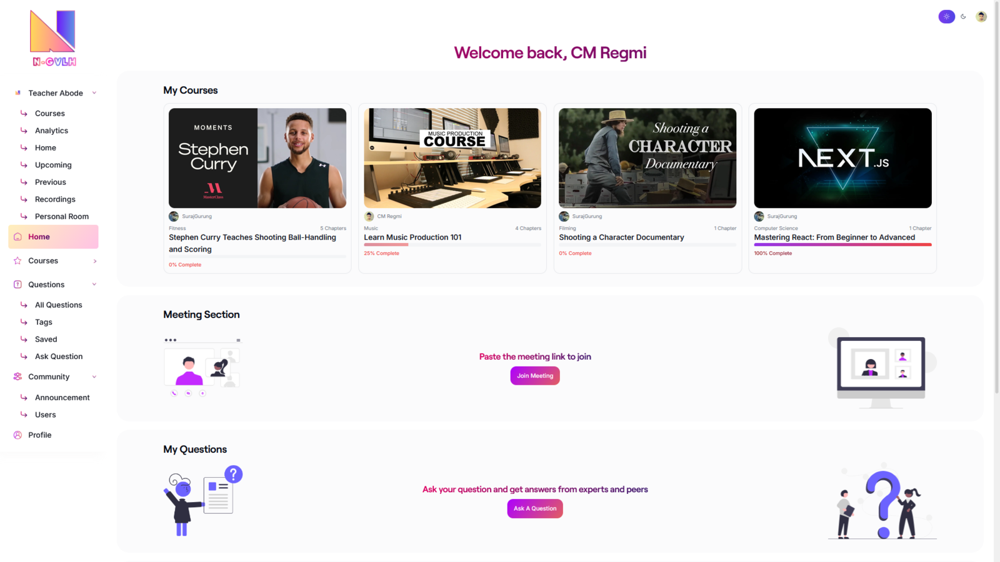
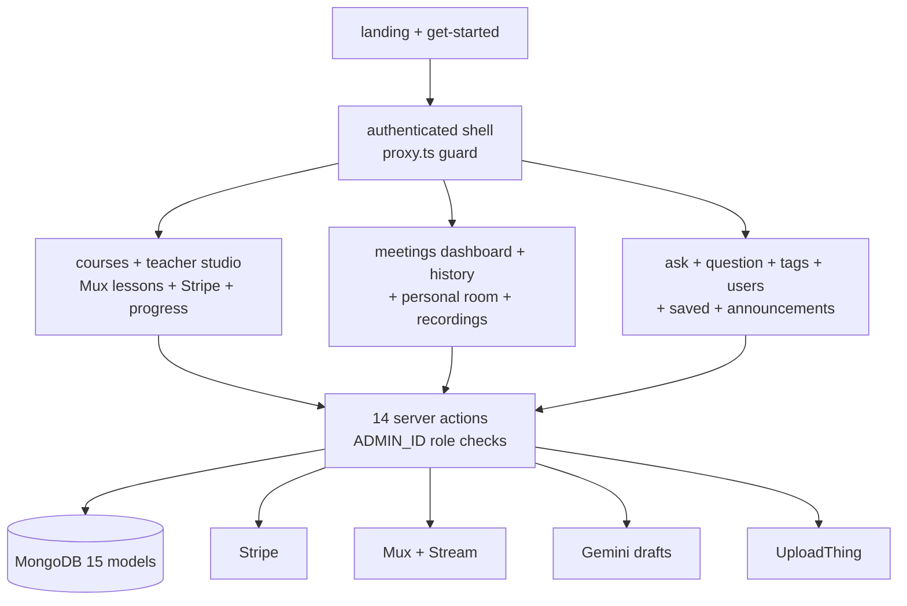

# N-GVLH

> One login for three classrooms: video courses with Stripe enrollment, Stream live meetings, and a Gemini-assisted Q&A community.

**Stack:** Next.js 16 · React 19 · Clerk + `proxy.ts` guard · Mongoose/MongoDB (15 models) · Stripe · Mux · Stream · UploadThing · Gemini



| Fact | Evidence |
| --- | --- |
| Three products, one shell | `(main)/(lms)` + `(meetings)` + `(qna)` route groups behind `proxy.ts` `auth.protect()` |
| 15 collections, 14 action modules | `database/*.modal.ts` + `lib/actions/` spanning courses, questions, meetings, purchases |
| Role-gated server actions | `ADMIN_ID_1/2` authorization in the actions layer; no `route.ts` API files |
| Marketing site included | Landing assets (`landing1/2`, illustrations, fonts) + `get-started` route |

## The Problem

Running courses, live classes, announcements, and Q&A usually means three disconnected tools with three logins. Learners lose context at every switch; teachers repeat answers across channels.

## The Solution

Route groups over centralized server actions: the LMS serves Mux/YouTube lessons with Stripe enrollment and progress confetti; Meetings serve Stream rooms with history and personal rooms; Q&A serves Markdown/code questions with votes, saves, follows, and Gemini-drafted answers. Clerk identity plus admin-ID checks gate every action; Mongo persists all three domains.



## Key Features

**Video courses with enrollment.** Mux + YouTube lessons, attachments, teacher studio, Stripe fulfillment, progress tracking. Why it matters: the paid learning loop funds everything else.

**Live meetings.** Stream rooms with dashboard, history, recordings, personal rooms under the same identity. Why it matters: learners need realtime teacher support without a second account.

**Community Q&A.** Ask/answer with Markdown and code, tags, votes, saves, follows, announcements. Why it matters: answered-once questions compound into a knowledge base.

**Gemini assistance.** Server-side draft answers for human review. Why it matters: drafts accelerate help without replacing it.

## Key Engineering Decisions

**Problem → Constraint → Decision → Tradeoff → Result**

1. **Three apps vs. one codebase.** Constraint: separate codebases triple auth, theming, and deployment work. Decision: route groups over a shared actions/Mongo layer with per-domain models. Tradeoff: 15 models and 14 action files in one repo — the largest surface in the portfolio. Result: one login, one theme, one search surface across learning, meetings, and Q&A.

2. **Actions instead of API routes.** Constraint: REST routes would duplicate role checks per endpoint. Decision: server actions with centralized `ADMIN_ID_*` authorization and webhook verification. Tradeoff: non-standard access patterns for API consumers. Result: authorization lives in one layer.

3. **Framework-version migration.** Constraint: Next 16 + React 19 changed async `params` and Stream session handling. Decision: the `3b862bc` migration commit (lockfile churn plus `proxy.ts` addition, Stream disconnect fix, Promise-typed params). Tradeoff: migration risk concentrated in one commit. Result: the stack runs on current Next/React.

## Iteration Story

Five commits only: initial import → two README passes → a community PR merge → the dependency/migration commit. Like `dokan`, this is a squashed-import history — the architecture is fully visible in the tree, but no incremental derivation is evidenced. Reviewers should read the route/action inventory, not the log.

## User Experience

Visitors land on marketing pages, then enter one shell with three sections. In LMS: browse, enroll via Stripe, watch, track progress. In Meetings: join live rooms, revisit history, use a personal room. In Q&A: ask with code blocks, answer, vote, save, follow teachers, read announcements. One login throughout.

## Results & Evidence

**Verifiable:** route groups, 15 models, 14 action files, `proxy.ts` public-route list, and the 22-key `.env.example` are all committed and reviewable.

**Not claimed:** no tests, deployment target (no Dockerfile/vercel config), or usage metrics are recorded. The `rehype-sanitize` hardening claim needs call-site verification before being cited.

## Technical Details

| Area | Detail |
| --- | --- |
| Framework | Next.js ^16.3.4, React 19, Tailwind 3.4 |
| Auth | `@clerk/nextjs` + `proxy.ts` (`/`, `/sign-in`, `/sign-up`, `/get-started`, `/api/webhooks` public) |
| Data | `mongoose` + `mongodb`, 15 models, cached `connectToDatabase()` |
| Services | `stripe`, `@mux/mux-node`, `@stream-io/video-react-sdk`, `uploadthing`, `@google/generative-ai`, TinyMCE |
| Secrets | `.env.example` (22 names: Clerk ×7, `MONGODB_URL`, Stream ×2, Mux ×2, Stripe ×2, UploadThing ×2, `GEMINI_API_KEY`, TinyMCE, app URL, `ADMIN_ID_1/2`). Nothing committed. |

## Setup

1. **Prerequisites:** Node 20+, npm, MongoDB, Clerk, Stripe, Mux, Stream, UploadThing, Google AI, TinyMCE accounts; Stripe/Clerk CLIs for webhooks.
2. **Clone and install:**
   ```bash
   git clone https://github.com/LowkeyGud/n-gvlh_project-ii.git
   cd n-gvlh_project-ii
   npm install
   ```
3. **Environment:** copy `.env.example` to `.env` and fill all 22 names; set the two admin Clerk user IDs.
4. **External services:** create each provider project; register Clerk and Stripe webhook endpoints against the app URL.
5. **Run:**
   ```bash
   npm run dev     # next dev --webpack
   ```
   Production: `npm run build` then `npm start`.
6. **Verify:** enroll in a course (test Checkout), join a meeting room, ask and answer a question with a code block.
7. **Common issues:** webhook failures → endpoint/secret mismatch; Stream disconnects → see the migration commit's session fix; admin actions denied → `ADMIN_ID_*` misconfigured.

No CI workflow is committed in this repo.

## Lessons / Takeaways

- Route groups scaled further than expected — three products share auth, theme, and search without entanglement.
- The actions-over-routes pattern centralized authorization but concentrated migration risk; the Wide migration commit is evidence of both.
- Next steps: per-surface tests and verifying the sanitization claim at call sites.

## Links

- Repository: `https://github.com/LowkeyGud/n-gvlh_project-ii`
- Live Demo: `https://n-gvlh.vercel.app/`

## Diagrams

Generated from the codebase with the mermaid-skill workflow (validate via Kroki → export SVG → vision self-check). Sources live in `docs/diagrams/` — edit the `.mmd`, re-render, review. SVG is the committed format.

**System architecture** (`docs/diagrams/architecture.mmd` — one shell, three products, shared actions layer):



## Screenshots

Captured from the live deployment:


